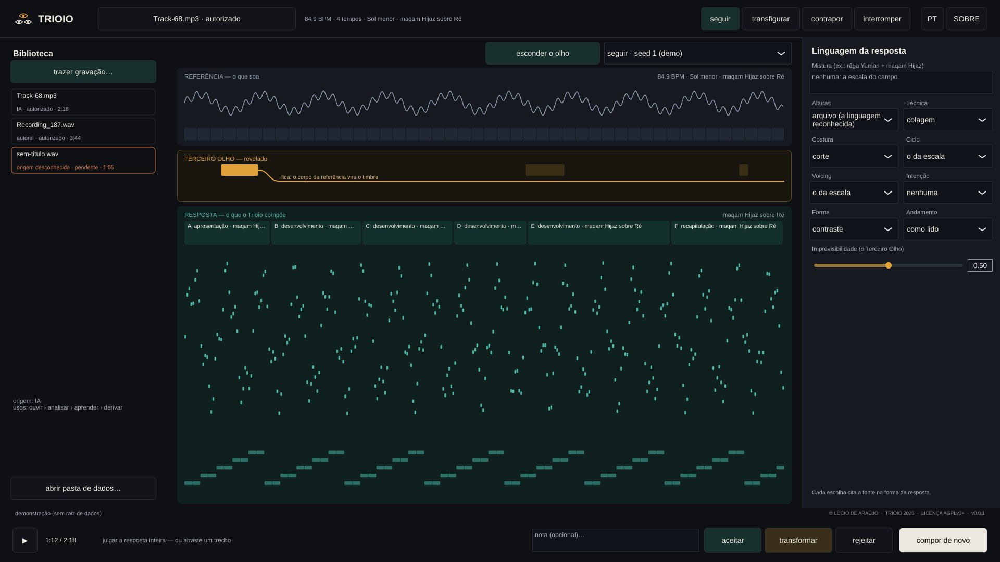

# Trioio

**Website:** [lucioaraujo.github.io/trioio](https://lucioaraujo.github.io/trioio/) ·
**Download:** [v0.1.1 release](https://github.com/lucioaraujo/trioio/releases/tag/v0.1.1) ·
**Contact:** **rasgo.instruments@gmail.com**

Languages:

- [English](#english)
- [Português](#português)
- [Français](#français)
- [Español](#español)

---

## English

**An instrument that listens.** You bring a recording; Trioio recognises
its pulse, harmony, melody and musical language, and composes a response of
its own, entirely synthesised. You judge the response, and Trioio learns
from your listening.

**Authorship:** Lúcio de Araújo · **Family:** [RASGO](https://rasgoinstruments.arquiviagem.net/) ·
**Version:** v0.1.1 (preview) · **License:** GNU AGPL-3.0-or-later (see [`LICENSE`](LICENSE)
and [`CREDITS_AND_SOURCES.md`](CREDITS_AND_SOURCES.md))

### What it is

Trioio is not played note by note. It is a conversation in four moves:

1. **You bring a recording**: the reference. It enters the Library with its
   provenance (who made it, by what right, for which uses). Without
   authorisation, nothing is analysed.
2. **Trioio listens**: pulse and metre, chords and key, the melody inside the
   mix, and the language (maqam, rāga, mode, flamenco…).
3. **It composes a response**: motif, phrases, form and harmony, synthesised
   with its own timbre families. Nothing is a sample; the reference's audio
   never enters the response.
4. **You judge**: you accept, transform or reject the whole response, a
   section or a stretch. The judgement becomes memory and moves the next
   responses.

**The Third Eye** is Trioio's unpredictable part: gestures, hidden rules and
sound objects that do not come from the reference. It stays hidden until you
have listened, so it does not steer your ear.

What Trioio carries, written by itself from published knowledge, with the
source cited in every entry:

- 2576 scales and 26 rhythmic cycles from many cultures;
- a harmony machine with 25 languages, from functional harmony and jazz to
  the Brazilian ones (Hermeto, Villa-Lobos, Moacir Santos, Guinga, Gismonti,
  frevo, maracatu), the modern ones and Partch's microtonality, with
  four-part voice leading;
- 15 ensembles (choro, samba, jazz, forró, tango, rock, orchestra, a
  cappella…), each voice with the instrument and the figure of the style.

### How you use it

- **Mode:** follow, transfigure, oppose or interrupt. This is the attitude of
  the response.
- **Words (optional):** a few words about the response you want, in any
  language, for example "dançante, maracatu, virada" or "cold rain, slow".
  Trioio reads the intention, form and dance, and shows what it understood.
  Left blank, it follows its own criteria.
- **Influences:** branches of an open tree (rock/noise,
  brasil/nordeste/maracatu…), with their social, historical and
  technological contexts. They are tendencies, never rules. The poetics of
  artists and bands are written by the musician, in a file of their own.
- **Gesture:** draw the intensity curve of the piece.
- **Compare:** listen to two versions A and B, switching at the same moment
  of the music.
- **Stems:** one WAV per voice, for a DAW.
- **File ▾**, next to the response: show its files in the folder, export them
  (WAV, MIDI, stems) wherever you choose, or move the response to the trash
  (it can be brought back).

The **TUTORIAL** button in the app explains everything step by step, in
English, Portuguese, French or Spanish.

**The internet is optional.** Trioio composes offline. Only the box "look up
unread words online" sends words to public services (Wikidata, Datamuse),
and it is off by default.

### Download

[**v0.1.1 release**](https://github.com/lucioaraujo/trioio/releases/tag/v0.1.1):
Windows `.exe` and portable `.zip`, macOS `.dmg`, Linux `.deb`, AppImage and
`.tar.gz`. All of them are built, tested and packaged by continuous
integration.

| Platform | Built and tested | Opened | Played by the author |
|---|---|---|---|
| Linux x86-64 | yes (48 tests) | yes; launch-tested on Debian 12, Ubuntu 24.04, Fedora and Arch | yes, on real hardware |
| Windows x86-64 | continuous integration (48 tests) | not yet on a real machine | not yet |
| macOS (Universal 2) | continuous integration (48 tests) | not yet on a real machine | not yet |

**Minimum requirements:**

| | |
|---|---|
| Windows | Windows 10 or 11, 64-bit |
| macOS | 10.15 or later; Intel or Apple Silicon |
| Linux | x86-64 with glibc 2.35+ (Ubuntu 22.04+, Debian 12+, Mint 21+) |
| Processor | 64-bit, two cores or more |
| Memory | about 250–500 MB while composing; a computer with 4 GB is enough |
| Disk | about 25 MB for the app, plus room for your responses |
| Audio | the system's default audio output |

The processor and memory figures were measured on an Intel Core i5-6500
(2015, 4 cores): a response takes about 20 s and uses about one core.
Details are in [`docs/MEDICOES.md`](docs/MEDICOES.md).

**On first launch, Windows and macOS show a security warning.** It is
expected: the app does not carry the paid signature of either company. What
to click on each system is in
[INSTALL.md → Installing, step by step](INSTALL.md#installing-step-by-step).
Common problems and what to do are in
[INSTALL.md → Troubleshooting](INSTALL.md#troubleshooting).

### Build from source

Requirements and steps are in [`INSTALL.md`](INSTALL.md#building-from-source).
JUCE 9.0.3 is not included in this repository. Development notes, in
Portuguese, are in [`DESENVOLVIMENTO.md`](DESENVOLVIMENTO.md), and the
detailed documentation is in [`docs/`](docs/). Code reused from other RASGO
instruments is a pinned copy in `third_party/`, with its origin and
checksums.

---

## Português

**Um instrumento que escuta.** Você traz uma gravação; o Trioio reconhece o
pulso, a harmonia, a melodia e a linguagem musical dela e compõe uma
resposta própria, toda sintetizada. Você julga a resposta, e o Trioio
aprende com a sua escuta.

**Autoria:** Lúcio de Araújo · **Família:** [RASGO](https://rasgoinstruments.arquiviagem.net/) ·
**Versão:** v0.1.1 (prévia) · **Licença:** GNU AGPL-3.0-or-later (ver [`LICENSE`](LICENSE)
e [`CREDITS_AND_SOURCES.md`](CREDITS_AND_SOURCES.md))

### O que é

O Trioio não se toca nota a nota. É uma conversa em quatro tempos:

1. **Você traz uma gravação**: a referência. Ela entra na Biblioteca com a
   proveniência (quem fez, com que direito, para quais usos). Sem
   autorização, nada é analisado.
2. **O Trioio escuta**: o pulso e o compasso, os acordes e a tonalidade, a
   melodia dentro da mistura e a linguagem (maqam, rāga, modo, flamenco…).
3. **Ele compõe uma resposta**: motivo, frases, forma e harmonia,
   sintetizados com famílias de timbre próprias. Nada é amostra; o áudio da
   referência nunca entra na resposta.
4. **Você julga**: aceita, transforma ou rejeita a resposta inteira, uma
   seção ou um trecho. O julgamento vira memória e move as próximas
   respostas.

**O Terceiro Olho** é a parte imprevisível do Trioio: gestos, regras ocultas
e objetos sonoros que não vêm da referência. Ele fica escondido até você
ouvir, para não guiar a sua escuta.

O que o Trioio carrega, escrito por ele mesmo a partir do conhecimento
publicado, com a fonte citada em cada entrada:

- 2576 escalas e 26 ciclos rítmicos de muitas culturas;
- uma máquina de harmonia com 25 linguagens, da funcional e do jazz às
  brasileiras (Hermeto, Villa-Lobos, Moacir Santos, Guinga, Gismonti, frevo,
  maracatu), às modernas e à microtonal de Partch, com condução a quatro
  vozes;
- 15 conjuntos (choro, samba, jazz, forró, tango, rock, orquestra, a
  cappella…), cada voz com o instrumento e a figura do estilo.

### Como se usa

- **Modo:** seguir, transfigurar, contrapor ou interromper. É a atitude da
  resposta.
- **Palavras (opcional):** algumas palavras sobre a resposta que você quer,
  em qualquer língua, por exemplo "dançante, maracatu, virada" ou "chuva
  fria, lento". O Trioio lê a intenção, a forma e a dança, e mostra o que
  entendeu. Em branco, segue os próprios critérios.
- **Influências:** ramos de uma árvore aberta (rock/noise,
  brasil/nordeste/maracatu…), com os seus contextos sociais, históricos e
  tecnológicos. São tendências, nunca regras. As poéticas de artistas e
  bandas, quem escreve é o músico, num arquivo próprio.
- **Gesto:** desenhe a curva de intensidade da peça.
- **Comparar:** ouça duas versões, A e B, alternando no mesmo instante da
  música.
- **Stems:** um WAV por voz, para a DAW.
- **Arquivo ▾**, junto da resposta: mostra os arquivos dela na pasta, exporta
  (WAV, MIDI, stems) para onde você escolher ou move a resposta para a
  lixeira (ela pode voltar).

O botão **TUTORIAL** do app explica tudo passo a passo, em português,
inglês, francês ou espanhol.

**A internet é opcional.** O Trioio compõe sem rede. Só a caixa "consultar
na rede as palavras não lidas" manda palavras a serviços públicos (Wikidata,
Datamuse), e ela vem desligada.

### Download

[**Release v0.1.1**](https://github.com/lucioaraujo/trioio/releases/tag/v0.1.1):
`.exe` e `.zip` portátil do Windows, `.dmg` do macOS, `.deb`, AppImage e
`.tar.gz` do Linux. Todos são construídos, testados e empacotados pela
integração contínua.

| Plataforma | Construído e testado | Aberto | Tocado pelo autor |
|---|---|---|---|
| Linux x86-64 | sim (48 testes) | sim; abertura testada em Debian 12, Ubuntu 24.04, Fedora e Arch | sim, em máquina real |
| Windows x86-64 | integração contínua (48 testes) | ainda não em máquina real | ainda não |
| macOS (Universal 2) | integração contínua (48 testes) | ainda não em máquina real | ainda não |

**Requisitos mínimos:**

| | |
|---|---|
| Windows | Windows 10 ou 11, 64 bits |
| macOS | 10.15 ou mais novo; Intel ou Apple Silicon |
| Linux | x86-64 com glibc 2.35+ (Ubuntu 22.04+, Debian 12+, Mint 21+) |
| Processador | 64 bits, dois núcleos ou mais |
| Memória | cerca de 250 a 500 MB enquanto compõe; um computador com 4 GB basta |
| Disco | cerca de 25 MB para o app, mais espaço para as suas respostas |
| Áudio | a saída de áudio padrão do sistema |

Os números de processador e memória foram medidos num Intel Core i5-6500
(2015, 4 núcleos): uma resposta leva cerca de 20 s e usa cerca de um
núcleo. Detalhes em [`docs/MEDICOES.md`](docs/MEDICOES.md).

**Na primeira abertura, o Windows e o macOS mostram um aviso de
segurança.** É esperado: o app não tem a assinatura paga das duas empresas.
Onde clicar em cada sistema está em
[INSTALL.md → Instalar, passo a passo](INSTALL.md#instalar-passo-a-passo).
Problemas comuns e o que fazer estão em
[INSTALL.md → Problemas e soluções](INSTALL.md#problemas-e-soluções).

### Compilar a partir do código

Requisitos e passos em [`INSTALL.md`](INSTALL.md#compilar-a-partir-do-código).
O JUCE 9.0.3 não vem neste repositório. As notas de desenvolvimento estão em
[`DESENVOLVIMENTO.md`](DESENVOLVIMENTO.md), e a documentação detalhada, em
[`docs/`](docs/). O código reaproveitado de outros instrumentos RASGO é uma
cópia fixada em `third_party/`, com a origem e os checksums.

---

## Français

**Un instrument qui écoute.** Vous apportez un enregistrement ; Trioio en
reconnaît la pulsation, l'harmonie, la mélodie et le langage musical, et
compose sa propre réponse, entièrement synthétisée. Vous jugez la réponse,
et Trioio apprend de votre écoute.

**Auteur :** Lúcio de Araújo · **Famille :** [RASGO](https://rasgoinstruments.arquiviagem.net/) ·
**Version :** v0.1.1 (aperçu) · **Licence :** GNU AGPL-3.0-or-later (voir [`LICENSE`](LICENSE)
et [`CREDITS_AND_SOURCES.md`](CREDITS_AND_SOURCES.md))

### Ce que c'est

Trioio ne se joue pas note à note. C'est une conversation en quatre temps :

1. **Vous apportez un enregistrement** : la référence. Il entre dans la
   Bibliothèque avec sa provenance (qui l'a fait, à quel titre, pour quels
   usages). Sans autorisation, rien n'est analysé.
2. **Trioio écoute** : la pulsation et la mesure, les accords et la
   tonalité, la mélodie dans le mixage et le langage (maqam, rāga, mode,
   flamenco…).
3. **Il compose une réponse** : motif, phrases, forme et harmonie,
   synthétisés avec ses propres familles de timbre. Rien n'est échantillon ;
   l'audio de la référence n'entre jamais dans la réponse.
4. **Vous jugez** : vous acceptez, transformez ou rejetez la réponse
   entière, une section ou un passage. Le jugement devient mémoire et oriente
   les réponses suivantes.

**Le Troisième Œil** est la part imprévisible de Trioio : gestes, règles
cachées et objets sonores qui ne viennent pas de la référence. Il reste caché
jusqu'à votre écoute, pour ne pas guider votre oreille.

Ce que Trioio porte, écrit par lui-même à partir du savoir publié, avec la
source citée pour chaque entrée :

- 2576 gammes et 26 cycles rythmiques de nombreuses cultures ;
- une machine harmonique de 25 langages, de l'harmonie fonctionnelle et du
  jazz aux langages brésiliens (Hermeto, Villa-Lobos, Moacir Santos, Guinga,
  Gismonti, frevo, maracatu), aux modernes et à la microtonalité de Partch,
  avec conduite à quatre voix ;
- 15 formations (choro, samba, jazz, forró, tango, rock, orchestre, a
  cappella…), chaque voix avec l'instrument et la figure du style.

### Comment s'en servir

- **Mode :** suivre, transfigurer, opposer ou interrompre. C'est l'attitude
  de la réponse.
- **Mots (facultatif) :** quelques mots sur la réponse voulue, dans
  n'importe quelle langue, par exemple « dançante, maracatu, virada » ou
  « pluie froide, lent ». Trioio lit l'intention, la forme et la danse, et
  montre ce qu'il a compris. Vide, il suit ses propres critères.
- **Influences :** les branches d'un arbre ouvert (rock/noise,
  brasil/nordeste/maracatu…), avec leurs contextes sociaux, historiques et
  technologiques. Ce sont des tendances, jamais des règles. Les poétiques
  d'artistes et de groupes, c'est le musicien qui les écrit, dans un
  fichier à lui.
- **Geste :** dessinez la courbe d'intensité de la pièce.
- **Comparer :** écoutez deux versions, A et B, en alternant au même
  instant de la musique.
- **Stems :** un WAV par voix, pour une STAN.
- **Fichier ▾**, à côté de la réponse : affiche ses fichiers dans le dossier,
  les exporte (WAV, MIDI, stems) où vous voulez, ou met la réponse à la
  corbeille (elle peut revenir).

Le bouton **TUTORIEL** de l'app explique tout pas à pas, en français,
anglais, portugais ou espagnol.

**Internet est facultatif.** Trioio compose hors ligne. Seule la case
« consulter en ligne les mots non lus » envoie des mots à des services
publics (Wikidata, Datamuse), et elle est désactivée par défaut.

### Téléchargement

[**Version v0.1.1**](https://github.com/lucioaraujo/trioio/releases/tag/v0.1.1) :
`.exe` et `.zip` portable pour Windows, `.dmg` pour macOS, `.deb`, AppImage
et `.tar.gz` pour Linux. Tous sont construits, testés et empaquetés par
l'intégration continue.

| Plateforme | Construit et testé | Ouvert | Joué par l'auteur |
|---|---|---|---|
| Linux x86-64 | oui (48 tests) | oui ; lancement testé sur Debian 12, Ubuntu 24.04, Fedora et Arch | oui, sur une vraie machine |
| Windows x86-64 | intégration continue (48 tests) | pas encore sur une vraie machine | pas encore |
| macOS (Universal 2) | intégration continue (48 tests) | pas encore sur une vraie machine | pas encore |

**Configuration minimale :** Windows 10 ou 11, 64 bits · macOS 10.15 ou
plus récent (Intel ou Apple Silicon) · Linux x86-64 avec glibc 2.35+
(Ubuntu 22.04+, Debian 12+, Mint 21+) · processeur 64 bits, deux cœurs ou
plus · environ 250 à 500 Mo de mémoire pendant la composition (4 Go dans
l'ordinateur suffisent) · environ 25 Mo de disque pour l'app · la sortie
audio par défaut du système. Mesuré sur un Intel Core i5-6500 (2015,
4 cœurs) : une réponse prend environ 20 s.

**Au premier lancement, Windows et macOS affichent un avertissement de
sécurité.** C'est attendu : l'app n'a pas la signature payante des deux
entreprises. Où cliquer, et les problèmes courants avec leurs solutions,
sont dans [`INSTALL.md`](INSTALL.md) (en anglais et en portugais).

### Compiler depuis les sources

Voir [`INSTALL.md`](INSTALL.md#building-from-source). JUCE 9.0.3 n'est pas
inclus. Les notes de développement, en portugais, sont dans
[`DESENVOLVIMENTO.md`](DESENVOLVIMENTO.md).

---

## Español

**Un instrumento que escucha.** Traes una grabación; Trioio reconoce su
pulso, armonía, melodía y lenguaje musical, y compone una respuesta propia,
toda sintetizada. Juzgas la respuesta, y Trioio aprende de tu escucha.

**Autoría:** Lúcio de Araújo · **Familia:** [RASGO](https://rasgoinstruments.arquiviagem.net/) ·
**Versión:** v0.1.1 (vista previa) · **Licencia:** GNU AGPL-3.0-or-later (ver [`LICENSE`](LICENSE)
y [`CREDITS_AND_SOURCES.md`](CREDITS_AND_SOURCES.md))

### Qué es

Trioio no se toca nota a nota. Es una conversación en cuatro tiempos:

1. **Traes una grabación**: la referencia. Entra en la Biblioteca con su
   procedencia (quién la hizo, con qué derecho, para qué usos). Sin
   autorización, nada se analiza.
2. **Trioio escucha**: el pulso y el compás, los acordes y la tonalidad, la
   melodía dentro de la mezcla y el lenguaje (maqam, rāga, modo, flamenco…).
3. **Compone una respuesta**: motivo, frases, forma y armonía, sintetizados
   con familias de timbre propias. Nada es muestra; el audio de la
   referencia nunca entra en la respuesta.
4. **Juzgas**: aceptas, transformas o rechazas la respuesta entera, una
   sección o un fragmento. El juicio se vuelve memoria y mueve las
   próximas respuestas.

**El Tercer Ojo** es la parte imprevisible de Trioio: gestos, reglas ocultas
y objetos sonoros que no vienen de la referencia. Permanece oculto hasta que
escuchas, para no guiar tu oído.

Lo que Trioio lleva, escrito por él mismo a partir del conocimiento
publicado, con la fuente citada en cada entrada:

- 2576 escalas y 26 ciclos rítmicos de muchas culturas;
- una máquina armónica con 25 lenguajes, de la armonía funcional y el jazz a
  los brasileños (Hermeto, Villa-Lobos, Moacir Santos, Guinga, Gismonti,
  frevo, maracatu), los modernos y la microtonalidad de Partch, con
  conducción a cuatro voces;
- 15 conjuntos (choro, samba, jazz, forró, tango, rock, orquesta, a
  cappella…), cada voz con el instrumento y la figura del estilo.

### Cómo se usa

- **Modo:** seguir, transfigurar, contraponer o interrumpir. Es la actitud
  de la respuesta.
- **Palabras (opcional):** algunas palabras sobre la respuesta que quieres,
  en cualquier idioma, por ejemplo «dançante, maracatu, virada» o «lluvia
  fría, lento». Trioio lee la intención, la forma y la danza, y muestra lo
  que entendió. En blanco, sigue sus propios criterios.
- **Influencias:** ramas de un árbol abierto (rock/noise,
  brasil/nordeste/maracatu…), con sus contextos sociales, históricos y
  tecnológicos. Son tendencias, nunca reglas. Las poéticas de artistas y
  bandas las escribe el músico, en un archivo propio.
- **Gesto:** dibuja la curva de intensidad de la pieza.
- **Comparar:** escucha dos versiones, A y B, alternando en el mismo
  instante de la música.
- **Stems:** un WAV por voz, para la DAW.
- **Archivo ▾**, junto a la respuesta: muestra sus archivos en la carpeta, los
  exporta (WAV, MIDI, stems) adonde elijas o mueve la respuesta a la papelera
  (puede volver).

El botón **TUTORIAL** de la app lo explica todo paso a paso, en español,
inglés, portugués o francés.

**Internet es opcional.** Trioio compone sin red. Solo la casilla
«consultar en la red las palabras no leídas» envía palabras a servicios
públicos (Wikidata, Datamuse), y viene desactivada.

### Descarga

[**Versión v0.1.1**](https://github.com/lucioaraujo/trioio/releases/tag/v0.1.1):
`.exe` y `.zip` portátil para Windows, `.dmg` para macOS, `.deb`, AppImage y
`.tar.gz` para Linux. Todos se construyen, prueban y empaquetan en la
integración continua.

| Plataforma | Construido y probado | Abierto | Tocado por el autor |
|---|---|---|---|
| Linux x86-64 | sí (48 pruebas) | sí; apertura probada en Debian 12, Ubuntu 24.04, Fedora y Arch | sí, en máquina real |
| Windows x86-64 | integración continua (48 pruebas) | aún no en máquina real | aún no |
| macOS (Universal 2) | integración continua (48 pruebas) | aún no en máquina real | aún no |

**Requisitos mínimos:** Windows 10 u 11, 64 bits · macOS 10.15 o más
reciente (Intel o Apple Silicon) · Linux x86-64 con glibc 2.35+ (Ubuntu
22.04+, Debian 12+, Mint 21+) · procesador de 64 bits, dos núcleos o más ·
unos 250 a 500 MB de memoria al componer (bastan 4 GB en el ordenador) ·
unos 25 MB de disco para la app · la salida de audio predeterminada del
sistema. Medido en un Intel Core i5-6500 (2015, 4 núcleos): una respuesta
tarda unos 20 s.

**En la primera apertura, Windows y macOS muestran un aviso de
seguridad.** Es lo esperado: la app no lleva la firma de pago de las dos
empresas. Dónde hacer clic, y los problemas comunes con sus soluciones,
están en [`INSTALL.md`](INSTALL.md) (en inglés y portugués).

### Compilar desde el código

Ver [`INSTALL.md`](INSTALL.md#building-from-source). JUCE 9.0.3 no está
incluido. Las notas de desarrollo, en portugués, están en
[`DESENVOLVIMENTO.md`](DESENVOLVIMENTO.md).
